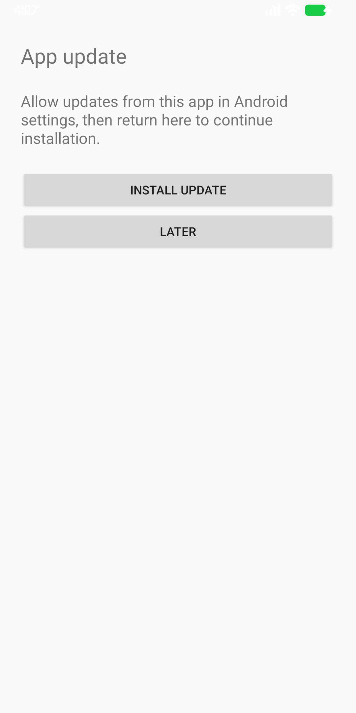

# Android updater

An Android library for apps distributed through Camille Studio. When an update is available, the app offers to download it, checks that the APK belongs to the installed app, and hands it to Android for approval.

[Integrate the updater](docs/integration.md)

## What the user sees

Open the app to check for an update, or choose **Check for updates** in its settings. **Later** dismisses the prompt. **Download update** shows progress, then opens Android’s installer. If Android asks for permission to install from this source, grant it and return to the app to continue. A failed download can be retried.

On Android 8 and newer the library verifies the file size, SHA-256, package name, version, minimum Android version and signer. It keeps the installed edition and debug or release channel, and selects an APK for the device’s CPU. On Android 5 through 7, a manual check opens the public release page.

*After returning from Android settings, you can continue the installation or choose Later.*

## Add it to an Android app

Use the AAR and checksum from the same version. Set `camille_update_app_id` to the app’s stable catalogue ID. The manifest starts foreground checks automatically. For a settings button, call `CamilleUpdater.checkNow(activity)`. The prompt and download screen follow the host activity’s English or French locale.

[Gradle setup and build commands](docs/integration.md) · [Source for 1.0.5](https://github.com/CamilleHbp/android-updater/tree/v1.0.5) · [Source for 1.0.6](https://github.com/CamilleHbp/android-updater/tree/v1.0.6) · [App downloads](https://download.camille.studio)

Tasks, Keyboard and Media use 1.0.5. Maps uses 1.0.6 to choose which activity hosts its update prompt.

## License

The updater and its Gradle wrapper use the [Apache License 2.0](LICENSE). The wrapper retains its upstream notices.
